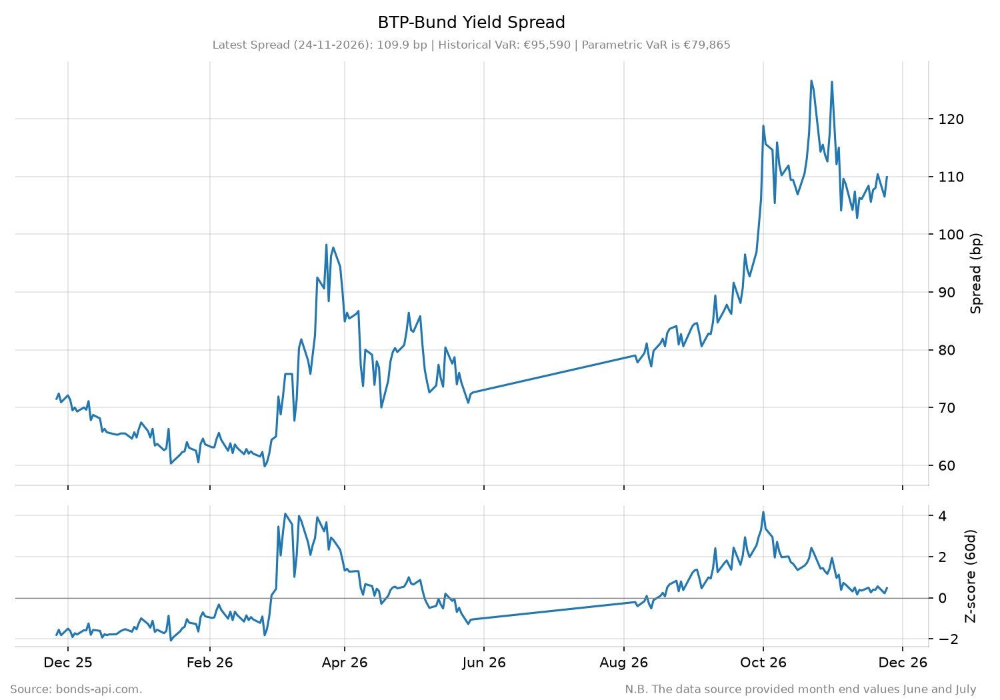

# BTP–Bund Spread Tracker

Python project tracking the spread between Italian (BTP) and German (Bund) 10-year government bond yields, a key indicator of Italy's sovereign risk.

## What it does
- Pulls daily 10Y yields for Italy and Germany from the bonds-api.com REST API
- Cleans and merges the two series with pandas and calculates the spread in basis points
- Plots the past 12 months with matplotlib
